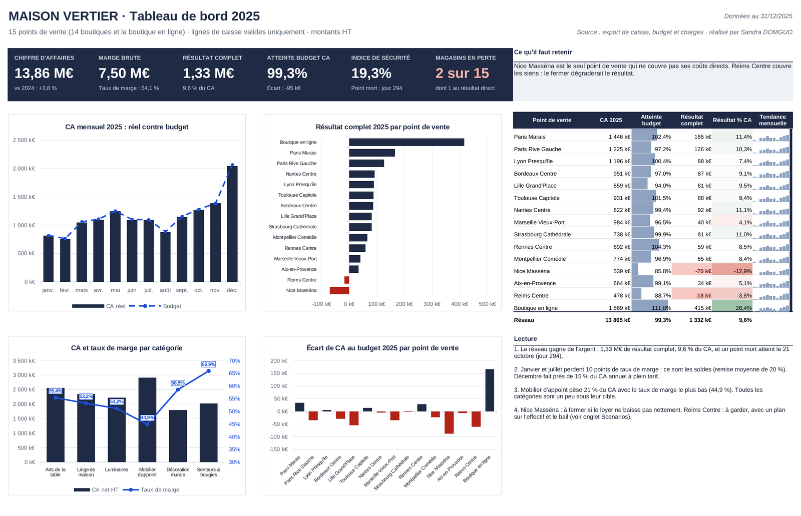

# MAISON VERTIER · faut-il fermer les deux magasins en perte ?

Analyse Excel de la rentabilité d'une enseigne de décoration : 14 boutiques et une boutique en ligne, 57 054 lignes d'export de caisse, exercices 2024 et 2025. Jeu de données fictif, construit pour l'exercice.

## La question

Le réseau fait 13,86 M€ de chiffre d'affaires (+3,8 %) et 1,33 M€ de résultat. Deux magasins affichent un résultat négatif : la direction demande s'il faut les fermer.

## La réponse

| 2025 | Nice Masséna | Reims Centre |
|---|---:|---:|
| Résultat direct (avant frais de siège) | −48,2 k€ | +1,1 k€ |
| Quote-part de frais de siège | 21,6 k€ | 19,2 k€ |
| Résultat complet | −69,8 k€ | −18,0 k€ |

Les frais de siège restent, que le magasin ferme ou non. Seul le résultat direct dit si le réseau gagne plus d'argent sans le magasin :

- **Nice Masséna** ne couvre pas ses propres coûts (loyer à 18,3 % du CA, personnel à 35,8 %). Le fermer améliore le résultat du réseau de 48 k€ par an.
- **Reims Centre** couvre ses coûts et absorbe une partie du siège. Le fermer coûterait environ 1 k€ au réseau et reporterait 19,2 k€ de frais de siège sur les autres magasins. Avec 3 ETP au lieu de 3,5 et 10 % de baisse de loyer, il passerait à +9,5 k€.

## Ce que contient le classeur

- **Contrôles** : 7 lignes aberrantes sur 57 054 (122 € de CA) marquées et exclues par une colonne `Ligne_valide`, jamais supprimées ; seuil de remise en paramètre.
- **Compte de résultat par magasin** : uniquement des SOMME.SI.ENS sur des tableaux structurés, l'année en paramètre.
- **Seuil de rentabilité et point mort** : par magasin, en direct et en complet ; le réseau atteint son point mort le 21 octobre (indice de sécurité de 19,3 %).
- **Scénarios** : fermeture ou plan d'action, magasin par magasin.
- **Tableaux croisés** : taux de marge en champ calculé, pour qu'il reste juste à tous les niveaux de filtre.
- **Tableau de bord** : une page A4 paysage, réel contre budget, résultat par point de vente.

## Recommandations

1. Nice Masséna : obtenir une baisse nette du loyer, à défaut fermer ou transférer (+48 k€ par an).
2. Reims Centre : garder le magasin avec un plan trimestriel sur l'effectif et le bail (de −18 k€ à +9,5 k€).
3. Soldes : encadrer la profondeur des remises (24 k€ de marge par point de remise en moins).

## Contenu du dossier

| Fichier | Contenu |
|---|---|
| `MAISON_VERTIER_analyse_2025.xlsx` | Le classeur complet (données, contrôles, analyses, TCD, tableau de bord) |
| `Note_synthese_VERTIER.pdf` | La note d'une page à la direction générale |
